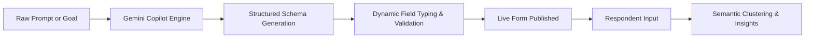

# Next-Gen Google Forms: Intelligent Enterprise Evolution
> *Architectural Blueprint & Feature Specification for Modern Data Collection*

[]()
[]()

---

## 📌 Executive Summary

While Google Forms is widely recognized for its simplicity, enterprise organizations require advanced intelligence, robust security, and deep workflow integration. This specification outlines **three foundational pillars** designed to modernize Google Forms into an enterprise-ready intelligent data collection and governance ecosystem.

```
┌─────────────────────────────────────────────────────────────────────────────┐
│                           NEXT-GEN GOOGLE FORMS                             │
├──────────────────────────┬──────────────────────────┬───────────────────────┤
│    1. LLM Integration    │ 2. Security & Protection │  3. Live Integration  │
│  • Prompt-to-Form Engine │  • Bot & DDoS Defense    │  • Real-Time Webhooks │
│  • Adaptive Branching    │  • Automated PII Redact  │  • Bi-Directional Sync│
│  • Semantic Synthesis    │  • E2EE & Zero-Trust     │  • Event Automations  │
└──────────────────────────┴──────────────────────────┴───────────────────────┘
```

---

## 🚀 Pillar 1: Intelligent LLM Integration (Form Copilot & Real-Time Reasoning)

Transforms passive question-and-answer lists into an adaptive, conversational, and self-analyzing copilot powered by Google Gemini.

### Key Capabilities
* **Prompt-to-Form Generator:** Instantly converts natural language objectives into complete multi-step forms with tailored field types, descriptive labels, and validation rules.
  * *Example Prompt:* `"Build a 10-step vendor security risk audit verifying cloud architecture, SOC 2 compliance, and incident response SLAs."`
* **Contextual Adaptive Branching:** Dynamically modifies downstream questions based on semantic reasoning over previous answers, rather than static routing trees.
* **Inline Answer Quality Linting:** Evaluates qualitative entries as the respondent types, suggesting additions if essential context is missing (e.g., specific dates, error codes, or departments).
* **Semantic Cluster Synthesis:** Automatically groups thousands of unstructured free-text responses into qualitative sentiment clusters, identifying key themes and providing executive-level summaries.



---

## 🛡️ Pillar 2: Enterprise Security, Anti-Abuse & Data Protection

A defense-in-depth security architecture protecting respondents, administrators, and sensitive organizational data against threats and unauthorized exposure.

| Security Layer | Defensive Mechanism | Impact / Protection |
| :--- | :--- | :--- |
| **Anti-Bot & Anti-Abuse** | Invisible challenge gates, browser fingerprinting, and sliding-window rate limiting | Eliminates ballot-stuffing, script flooding, and automated spam attacks without annoying CAPTCHAs. |
| **DLP & PII Redaction** | Real-time pattern detection for SSNs, credit cards, credentials, and PHI | Automatically masks sensitive data prior to disk persistence or spreadsheet streaming. |
| **Zero-Trust Access** | SAML 2.0 / OAuth SSO, Google Workspace 2FA, and ephemeral token links | Stops unauthorized access and eliminates leaked public link exposure. |
| **Granular RBAC** | Multi-role access control (Admin, Creator, Reviewer, Read-Only Auditor) | Prevents privilege escalation and unauthorized form schema or submission tampering. |
| **Encryption Standards** | In-transit (TLS 1.3) and at-rest field-level encryption with CMEK | Guarantees compliance with strict financial and healthcare standards (SOC 2, HIPAA, GDPR). |
| **Payload Sanitization** | Sandboxed virus/malware scanning on file uploads and strict input XSS filters | Blocks malicious executable injection, reverse shells, and cross-site scripting. |
| **Tamper-Evident Auditing** | Append-only, cryptographic event logs recording views, exports, and changes | Full traceability for legal hold, internal compliance audits, and forensic review. |

---

## ⚡ Pillar 3: Live API Verification & Workflow Connectors

Eliminates data silos by turning Google Forms into an active operational hub with bi-directional syncing and automated actions.

### Key Capabilities
* **Real-Time Database Validation:** Intercepts submission payloads via secure webhooks to validate data against external sources before acceptance:
  * Employee IDs via Workday/BambooHR
  * Corporate email domain legitimacy
  * Tax IDs (VAT/GST) via national registries
  * Customer accounts via Salesforce/HubSpot
* **Bi-Directional Workspace Synchronization:** Establishes live two-way sync with Google Sheets, BigQuery, and enterprise data warehouses—edits in Sheets immediately reflect across form records without manual re-exports.
* **Trigger-Based Event Automations:** Automatically initiates conditional business workflows upon submission:
  * Escalates urgent support tickets directly into Jira or ServiceNow.
  * Dispatches real-time incident alerts to Slack or PagerDuty.
  * Generates and routes dynamic contracts for e-signature.

---

## 📊 Feature Comparison Matrix

| Feature Dimension | Traditional Google Forms | Next-Gen Enterprise Google Forms |
| :--- | :---: | :---: |
| **Form Creation** | Manual drag-and-drop | Natural language prompt-to-form |
| **Routing Logic** | Static "go to section" rules | Dynamic LLM-driven adaptive branching |
| **Spam & Abuse Defense** | Basic reCAPTCHA | Invisible behavioral fingerprinting + rate limiting |
| **Sensitive Data Handling** | Plain text storage | Automated DLP redaction + CMEK encryption |
| **Data Validation** | Basic regex (email, number) | Live external API verification webhooks |
| **Sheet Connectivity** | One-way append only | Bi-directional real-time synchronization |
| **Reporting & Insights** | Basic summary pie charts | AI semantic clustering & theme extraction |

---

## 🛠️ Implementation Architecture

```
┌─────────────────────────────────────────────────────────────────────────────┐
│                              CLIENT BROWSER                                 │
│  • Adaptive Conversational Mode      • Inline Input Quality Linting         │
│  • Behavioral Anti-Bot Signals       • File Type & Payload Size Pre-Checks  │
└──────────────────────────────────────┬──────────────────────────────────────┘
                                       │ HTTPS / TLS 1.3
                                       ▼
┌─────────────────────────────────────────────────────────────────────────────┐
│                            API GATEWAY & SECURITY                           │
│  • Rate Limiting (Token Bucket)      • SAML 2.0 / Workspace 2FA Auth        │
│  • WAF & Input Sanitization (XSS)    • Ephemeral Token Verification         │
└──────────────────────────────────────┬──────────────────────────────────────┘
                                       │
                 ┌─────────────────────┴─────────────────────┐
                 ▼                                           ▼
┌─────────────────────────────────┐         ┌─────────────────────────────────┐
│     AI & COPILOT SERVICES       │         │    ENTERPRISE CORE SERVICES     │
│  • Google Gemini Pro Reasoning  │         │  • Dynamic Schema Engine        │
│  • Semantic Cluster Analysis    │         │  • RBAC & Access Matrix         │
│  • Contextual Branching Adapter │         │  • DLP & PII Redactor           │
└────────────────┬────────────────┘         └────────────────┬────────────────┘
                 │                                           │
                 └─────────────────────┬─────────────────────┘
                                       │
                                       ▼
┌─────────────────────────────────────────────────────────────────────────────┐
│                       STORAGE & WORKFLOW INTEGRATION                        │
│  • CMEK-Encrypted Database (PostgreSQL/Spanner)                             │
│  • Bi-Directional Google Sheets / BigQuery Streaming                        │
│  • Live Webhook Engine (Salesforce, Workday, Slack, Webhooks)               │
└─────────────────────────────────────────────────────────────────────────────┘
```

---

## 📄 Attribution & Purpose

Designed for enterprise teams seeking modern, secure, and AI-first data collection architectures.
